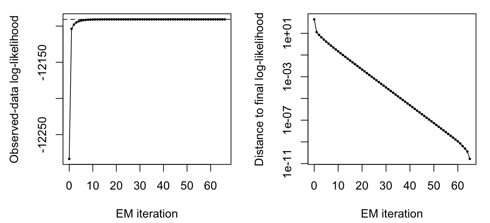
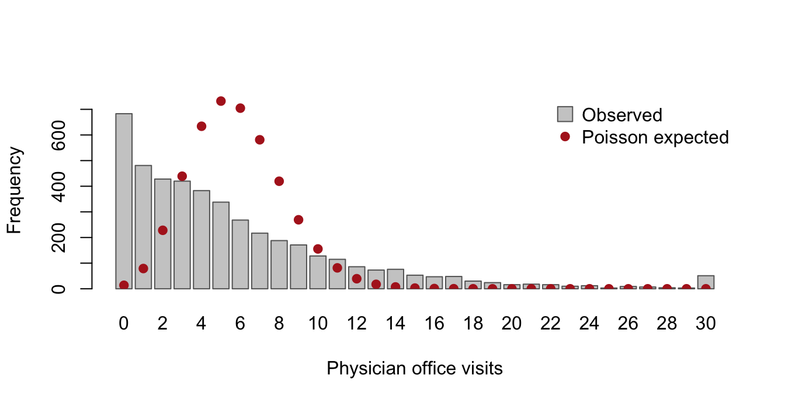

# Negative Binomial and Zero-Inflated Negative Binomial Regression by IRLS and EM

## 1 Introduction

Many data in health research are counts: the number of hospital visits
in a month, or the number of research papers published. Poisson
regression is useful in that case, but it has a very strong assumption:
the mean and the variance must be equal. This is rarely true in a real
data set. Most count data are overdispersed, with a variance greater
than the mean, and many data sets also contain more zeros than a Poisson
distribution allows.

The negative binomial (NB2) model handles overdispersion with a
dispersion parameter $`\theta`$, so that
$`\mathrm{Var}(Y) = \mu + \mu^2/\theta`$. When the extra zeros come from
a different process, for example a person who never sees a doctor, a
zero-inflated negative binomial (ZINB) model fits more naturally. It
treats each observation either as a structural zero or as a draw from an
NB distribution, which can itself be zero.

In this project, I built the R package **nbzinbHossen**, which fits both
models:

- NB regression by iteratively reweighted least squares (IRLS),
  alternated with Newton–Raphson updates of $`\log\theta`$;
- ZINB regression by an EM algorithm whose M-steps are IRLS fits.

I did not use any general-purpose optimizer such as
[`optim()`](https://rdrr.io/r/stats/optim.html), or
[`glm()`](https://rdrr.io/r/stats/glm.html) fitting code. I check the
package against
[`MASS::glm.nb()`](https://rdrr.io/pkg/MASS/man/glm.nb.html) and
[`pscl::zeroinfl()`](https://rdrr.io/pkg/pscl/man/zeroinfl.html) on two
data sets, test by simulation whether
[`zinbreg()`](https://armanhossen-am.github.io/nbzinbHossen/reference/zinbreg.md)
recovers known parameters, and use it to analyse the NMES1988 data.

## 2 Methods

### 2.1 Negative binomial (NB2) regression

For counts $`Y_i`$ with covariates $`x_i`$, offset $`o_i`$ and prior
weights $`a_i`$,
``` math
P(Y_i = y) = \frac{\Gamma(y+\theta)}{\Gamma(\theta)\,y!}
\Big(\frac{\theta}{\theta+\mu_i}\Big)^{\theta}
\Big(\frac{\mu_i}{\theta+\mu_i}\Big)^{y},
\qquad \log\mu_i = \eta_i = x_i^\top\beta + o_i,
```
so $`E(Y_i)=\mu_i`$ and $`\mathrm{Var}(Y_i)=\mu_i+\mu_i^2/\theta`$. The
log-likelihood is
``` math
\ell(\beta,\theta)=\sum_i a_i\big[\log\Gamma(y_i+\theta)-\log\Gamma(\theta)
-\log y_i!+\theta\log\theta+y_i\log\mu_i-(\theta+y_i)\log(\theta+\mu_i)\big].
```

**IRLS for $`\beta`$ ($`\theta`$ fixed).** With the log link,
$`(\partial\mu/\partial\eta)^2=\mu^2`$, so Fisher scoring is weighted
least squares with
``` math
w_i = a_i\frac{\theta\mu_i}{\theta+\mu_i},\qquad
z_i = (\eta_i-o_i) + \frac{y_i-\mu_i}{\mu_i},\qquad
\beta^{(t+1)} = (X^\top W X)^{-1}X^\top W z .
```
The solve uses the QR decomposition of $`W^{1/2}X`$. Because the log
link is not canonical for the NB, a Fisher-scoring step is not
guaranteed to increase $`\ell`$, so the step is halved whenever $`\ell`$
would decrease.

**Newton–Raphson for $`\theta`$ ($`\beta`$ fixed).** With $`\psi`$ and
$`\psi'`$ the digamma and trigamma functions,
``` math
U(\theta)=\sum_i a_i\Big[\psi(y_i+\theta)-\psi(\theta)+\log\theta+1-\log(\theta+\mu_i)-\frac{y_i+\theta}{\theta+\mu_i}\Big],
```
``` math
H(\theta)=\sum_i a_i\Big[\psi'(y_i+\theta)-\psi'(\theta)+\frac1\theta-\frac{2}{\theta+\mu_i}+\frac{y_i+\theta}{(\theta+\mu_i)^2}\Big].
```
We update $`\phi=\log\theta`$, which keeps $`\theta>0`$:
$`U_\phi=\theta U`$, $`H_\phi=\theta^2H+\theta U`$,
$`\phi\leftarrow\phi-U_\phi/H_\phi`$. If $`H_\phi\ge 0`$ a unit step in
the direction of $`U_\phi`$ is taken, and steps are halved until
$`\ell`$ does not decrease.

**Outer loop.** Start from a Poisson IRLS fit and the moment estimate
$`\theta_0=\sum_i a_i/\sum_i a_i(y_i/\mu_i-1)^2`$. Then alternate the
two updates until $`|\ell^{(t+1)}-\ell^{(t)}|<10^{-8}`$. If $`\theta`$
reaches a large cap ($`10^6`$) the data show no overdispersion and a
warning is given.

**Standard errors.** As in `glm.nb()`,
$`\widehat{\mathrm{Var}}(\hat\beta)=(X^\top\hat WX)^{-1}`$ treating
$`\theta`$ as known, and
$`\mathrm{SE}(\hat\theta)=\{-H(\hat\theta)\}^{-1/2}`$.

### 2.2 Zero-inflated negative binomial regression

With probability $`\pi_i`$ observation $`i`$ is a structural zero,
otherwise it is NB$`(\mu_i,\theta)`$:
``` math
P(Y_i=0)=\pi_i+(1-\pi_i)f_0(\mu_i,\theta),\quad
P(Y_i=y)=(1-\pi_i)f_{NB}(y;\mu_i,\theta),\ y\ge1,
```
where $`f_0=\{\theta/(\theta+\mu_i)\}^\theta`$,
$`\log\mu_i=x_i^\top\beta+o_i`$ and
$`\mathrm{logit}\,\pi_i=z_i^\top\gamma`$. The observed-data
log-likelihood
``` math
\ell(\beta,\gamma,\theta)=\sum_{y_i=0}\log\big[\pi_i+(1-\pi_i)f_0\big]
+\sum_{y_i>0}\big[\log(1-\pi_i)+\log f_{NB}(y_i;\mu_i,\theta)\big]
```
contains the log of a sum, so it is not an exponential-family GLM
likelihood and cannot be maximized by IRLS directly. We use the EM
algorithm with latent indicators $`D_i=1`$ for structural zeros.

**E-step.** $`\tau_i=P(D_i=1\mid y_i)=\pi_i/\{\pi_i+(1-\pi_i)f_0\}`$ if
$`y_i=0`$, and $`\tau_i=0`$ if $`y_i>0`$.

**M-step, zero part.** Maximize
$`\sum_i[\tau_i\log\pi_i+(1-\tau_i)\log(1-\pi_i)]`$: a logistic
regression with fractional response $`\tau_i`$, fitted by IRLS with
$`w_i=\pi_i(1-\pi_i)`$ and
$`z_i=z_i^\top\gamma+(\tau_i-\pi_i)/\{\pi_i(1-\pi_i)\}`$.

**M-step, count part.** Maximize
$`\sum_i(1-\tau_i)\log f_{NB}(y_i;\mu_i,\theta)`$: exactly the NB fit
above with prior weights $`a_i=1-\tau_i`$, warm-started at the current
$`(\beta,\theta)`$.

**Starting values and convergence.** $`(\beta,\theta)`$ come from the NB
fit and $`\gamma`$ from an IRLS logistic regression of $`I(y_i=0)`$ on
$`z_i`$. EM stops when $`\ell`$ changes by less than $`10^{-10}`$. The
package records $`\ell`$ at every iteration and warns if it ever
decreases. This never happened in any fit reported here.

**Standard errors (analytic Hessian).** EM gives no standard errors, so
we invert the observed information of $`\ell`$ in
$`(\beta,\gamma,\log\theta)`$. Each $`\ell_i`$ depends on $`\beta`$ only
through $`\eta_i`$ and on $`\gamma`$ only through
$`\zeta_i=z_i^\top\gamma`$. The Hessian is therefore built from
per-observation second derivatives, e.g.
$`H_{\beta\beta}=X^\top\mathrm{diag}(a_i\,\partial^2\ell_i/\partial\eta_i^2)X`$.
For $`y_i>0`$ these are NB and logistic derivatives, e.g.
$`\partial^2\ell_i/\partial\eta_i^2=-\theta\mu_i(\theta+y_i)/(\theta+\mu_i)^2`$.
For $`y_i=0`$, write $`\ell_i=\log L_i`$ with
$`L_i=\pi_i+(1-\pi_i)e^{g_i}`$ and
$`g_i=\theta\log\{\theta/(\theta+\mu_i)\}`$. With
$`r_i=(1-\pi_i)e^{g_i}/L_i=1-\tau_i`$ and
$`\partial r_i/\partial g_i=r_i(1-r_i)`$,
``` math
\frac{\partial^2\ell_i}{\partial u\,\partial v}=r_i\,g_{i,uv}+r_i(1-r_i)\,g_{i,u}\,g_{i,v},
\qquad u,v\in\{\eta_i,\log\theta\},
```
and the cross terms with $`\zeta_i`$ are
$`-\pi_i(1-\pi_i)e^{g_i}g_{i,u}/L_i^2`$. All terms are listed in
`R/zinb_hessian.R`. The analytic Hessian agrees with
[`numDeriv::hessian()`](https://rdrr.io/pkg/numDeriv/man/hessian.html)
to about $`10^{-7}`$ relative error (checked in the tests). We report
$`\log\theta`$ with its SE, as `zeroinfl()` does, and
$`\mathrm{SE}(\hat\theta)=\hat\theta\,\mathrm{SE}(\log\hat\theta)`$ by
the delta method.

## 3 The R package

The package **nbzinbHossen** is installed with

\
`devtools``::`[`install_github`](https://devtools.r-lib.org/reference/install-deprecated.html)`(``"armanhossen-am/nbzinbHossen"``)`

| Function | Purpose |
|----|----|
| `nbreg(formula, data, subset, na.action, weights, offset, control)` | NB regression by IRLS + Newton–Raphson for $`\log\theta`$ |
| `zinbreg(formula, data, subset, na.action, weights, offset, control)` | ZINB regression by EM with IRLS M-steps; formula `y ~ count | zero` |
| [`nbreg_control()`](https://armanhossen-am.github.io/nbzinbHossen/reference/nbreg_control.md), [`zinbreg_control()`](https://armanhossen-am.github.io/nbzinbHossen/reference/zinbreg_control.md) | tolerances, iteration limits, `trace`, Hessian type |

Both functions return S3 objects (`"nbreg"`, `"zinbreg"`) holding the
coefficients, covariance matrix, $`\hat\theta`$ and its SE,
log-likelihood, number of iterations, a convergence flag, fitted values
and the call. Methods: `print`, `summary` (+ `print.summary`), `coef`,
`vcov`, `logLik` (with a `df` attribute, so
[`AIC()`](https://rdrr.io/r/stats/AIC.html)/[`BIC()`](https://rdrr.io/r/stats/AIC.html)
work), `fitted`, `residuals` (response, Pearson; deviance for NB),
`nobs` and `predict` with `newdata` (`type = "response"`, `"count"`,
`"zero"` and `"prob"` for ZINB). The numerical work is in `R/utils.R`
(weighted least squares, IRLS and Newton–Raphson loops), `R/nbreg.R`,
`R/zinbreg.R` and `R/zinb_hessian.R`; none of it calls
[`optim()`](https://rdrr.io/r/stats/optim.html),
[`glm()`](https://rdrr.io/r/stats/glm.html),
[`lm()`](https://rdrr.io/r/stats/lm.html) or any other fitting routine.
Tests in `tests/testthat/` compare both functions with the reference
implementations and check offsets, weights, single-covariate models, EM
monotonicity, error messages and warnings.
[`devtools::check()`](https://devtools.r-lib.org/reference/check.html)
gives 0 errors, 0 warnings and 0 notes, and the GitHub Actions workflow
runs it on macOS, Windows and Linux.

A short example:

\
`fit`` ``<-`` `[`zinbreg`](https://armanhossen-am.github.io/nbzinbHossen/reference/zinbreg.md)`(``art`` ``~`` ``fem`` ``+`` ``kid5`` ``+`` ``ment`` ``|`` ``ment``, data ``=`` ``bioChemists``)`\
[`round`](https://rdrr.io/r/base/Round.html)`(`[`coef`](https://rdrr.io/r/stats/coef.html)`(``fit``)``, ``3``)`

    count_(Intercept)    count_femWomen        count_kid5        count_ment
                0.494            -0.228            -0.131             0.024
     zero_(Intercept)         zero_ment
               -0.795            -0.619 

\
`fit``$``theta`

    [1] 2.695733

\
[`predict`](https://rdrr.io/r/stats/predict.html)`(``fit``, newdata ``=`` `[`data.frame`](https://rdrr.io/r/base/data.frame.html)`(``fem ``=`` ``"Women"``, kid5 ``=`` ``0``, ment ``=`` `[`c`](https://rdrr.io/r/base/c.html)`(``0``, ``20``)``)``,`\
`        type ``=`` ``"zero"``)`

               1            2
    3.111162e-01 1.883220e-06 

## 4 Benchmarking

We compare our fits with `glm.nb()` (with `epsilon = 1e-10`) and
`zeroinfl()` (with `reltol = 1e-12`) on
[`pscl::bioChemists`](https://rdrr.io/pkg/pscl/man/bioChemists.html) (n
= 915) and [`AER::NMES1988`](https://rdrr.io/pkg/AER/man/NMES1988.html)
(n = 4406), using the full models of Section 5 of the project
description. [Table 1](#tbl-agree) summarizes the maximum absolute
differences. Every one is far inside the required tolerance. The
side-by-side estimates are in the appendix ([Table 8](#tbl-bio-nb) to
[Table 11](#tbl-nmes-zinb)).

| Quantity | NB bioChemists | NB NMES1988 | NB tolerance | ZINB bioChemists | ZINB NMES1988 | ZINB tolerance |
|:---|---:|---:|---:|---:|---:|---:|
| Coefficients | 2.3e-07 | 2.1e-07 | 1.0e-05 | 1.5e-05 | 5.4e-06 | 1.0e-03 |
| Standard errors | 2.4e-09 | 5.8e-10 | 1.0e-05 | 8.5e-06 | 3.0e-06 | 1.0e-03 |
| theta (NB) / log theta (ZINB) | 9.0e-08 | 5.9e-09 | 1.0e-04 | 1.2e-06 | 8.7e-07 | 1.0e-03 |
| Log-likelihood | 2.1e-11 | 5.5e-12 | 1.0e-04 | 4.2e-10 | 1.0e-09 | 1.0e-03 |

Table 1: Maximum absolute difference from the reference implementation,
with the required tolerance.

| Data / model     |  Ours | Reference | logLik ours | logLik reference |
|:-----------------|------:|----------:|------------:|-----------------:|
| bioChemists NB   | 0.010 |     0.024 |   -1560.958 |        -1560.958 |
| bioChemists ZINB | 0.564 |     0.058 |   -1549.991 |        -1549.991 |
| NMES1988 NB      | 0.041 |     0.088 |  -12170.554 |       -12170.554 |
| NMES1988 ZINB    | 1.430 |     0.263 |  -12090.722 |       -12090.722 |

Table 2: Elapsed time (seconds) of one fit, and log-likelihoods.

[`nbreg()`](https://armanhossen-am.github.io/nbzinbHossen/reference/nbreg.md)
is about as fast as `glm.nb()`.
[`zinbreg()`](https://armanhossen-am.github.io/nbzinbHossen/reference/zinbreg.md)
is several times slower than `zeroinfl()` because EM converges linearly:
it needed 135 iterations on bioChemists and 66 on NMES1988, each with a
full IRLS fit in both M-steps. Every fit still takes under a second.



Figure 1: EM convergence of zinbreg() on NMES1988. Left: the
observed-data log-likelihood at every iteration; the dashed line is the
value from zeroinfl(). Right: the distance to the final log-likelihood,
on a log scale.

[Figure 1](#fig-em) shows that the log-likelihood never decreases, as EM
guarantees. Almost all of the gain comes in the first few iterations.
After that, the distance to the optimum shrinks by a roughly constant
factor per iteration, a straight line on the log scale: the linear
convergence typical of EM.

## 5 Simulation study

We simulated $`R = 200`$ data sets of size $`n = 500`$ from a ZINB model
with $`\log\mu_i = 1 + 0.5x_{1i} - 0.4x_{2i}`$, where $`x_1\sim N(0,1)`$
and $`x_2\sim\mathrm{Bernoulli}(0.5)`$. The zero part is
$`\mathrm{logit}\,\pi_i = -1 + 0.8w_i`$ with $`w\sim N(0,1)`$, and
$`\theta = 1.5`$. Each data set was fitted with
`zinbreg(y ~ x1 + x2 | w)` (seed 651). 200 of 200 fits converged, with a
median of 88 EM iterations. [Table 3](#tbl-sim) reports the bias, the
mean estimated SE against the Monte Carlo SD of the estimates, and the
coverage of 95% Wald intervals. With 200 replications the Monte Carlo
standard error of a coverage near 0.95 is about 0.015.

| Parameter          |   True | Mean estimate |   Bias | MC SD | Mean SE | Coverage |
|:-------------------|-------:|--------------:|-------:|------:|--------:|---------:|
| count\_(Intercept) |  1.000 |         0.987 | -0.013 | 0.104 |   0.098 |    0.940 |
| count_x1           |  0.500 |         0.500 |  0.000 | 0.064 |   0.062 |    0.925 |
| count_x2           | -0.400 |        -0.393 |  0.007 | 0.141 |   0.121 |    0.905 |
| zero\_(Intercept)  | -1.000 |        -1.065 | -0.065 | 0.356 |   0.322 |    0.945 |
| zero_w             |  0.800 |         0.840 |  0.040 | 0.244 |   0.231 |    0.935 |
| Log(theta)         |  0.405 |         0.435 |  0.029 | 0.253 |   0.238 |    0.915 |

Table 3: Simulation results (R = 200, n = 500).

The estimates are close to unbiased. The largest bias, $`-0.065`$ for
the zero-part intercept, is less than a fifth of that estimate’s Monte
Carlo SD, and the count-part slopes are essentially unbiased.

The average estimated SEs track the Monte Carlo SDs but are slightly
smaller for most parameters, most visibly for the binary covariate
$`x_2`$ (0.121 against 0.141). Coverage of the 95% Wald intervals runs
from 0.905 to 0.945. With a Monte Carlo SE of about 0.015, the intervals
for $`x_2`$ (0.905) and $`\log\theta`$ (0.915) under-cover slightly.

Both shortfalls are plausible at $`n = 500`$. A binary covariate carries
less information than a continuous one, and $`\theta`$ is partly
confounded with the zero-inflation probability, since both change how
many zeros appear. The zero-part intercept is the least precisely
estimated parameter (MC SD 0.36), because only the zeros carry
information about $`\pi`$.

## 6 Data analysis: NMES1988

The data have $`n = 4406`$ individuals aged 66 and over. The response is
`visits`, the number of physician office visits. The count part uses
`hospital`, `health`, `chronic`, `gender`, `school` and `insurance`; the
zero part uses `hospital`, `chronic`, `gender`, `school` and
`insurance`.

### 6.1 Descriptive summary

| n | Mean | Variance | Variance / mean | Observed zeros | Proportion zero | Poisson P(0) at mean |
|---:|---:|---:|---:|---:|---:|---:|
| 4406 | 5.774 | 45.687 | 7.912 | 683 | 0.155 | 0.003 |

Table 4: Overdispersion and zeros in visits.



Figure 2: Observed frequencies of visits (bars, 30 = 30 or more) and
frequencies expected under a Poisson distribution with the same mean
(points).

Visits are strongly overdispersed: the variance (45.7) is almost eight
times the mean (5.77). There are also far more zeros than a Poisson
model allows. 683 people (15.5%) made no visits, while a Poisson
distribution with the same mean puts only 0.3% of its mass at zero,
about 14 people. [Figure 2](#fig-freq) shows the Poisson missing both
the spike at zero and the long right tail, which reaches 89 visits.

### 6.2 Model comparison

| Model          |  df |   logLik |     AIC |     BIC | Expected zeros |
|:---------------|----:|---------:|--------:|--------:|---------------:|
| Poisson (glm)  |   8 | -17971.6 | 35959.2 | 36010.4 |           46.7 |
| NB (nbreg)     |   9 | -12170.6 | 24359.1 | 24416.6 |          608.0 |
| ZINB (zinbreg) |  15 | -12090.7 | 24211.4 | 24307.3 |          708.8 |

Table 5: Model comparison for NMES1988.

The observed number of zeros is 683. The NB model estimates
$`\hat\theta = 1.207`$ (SE 0.034) and the ZINB model
$`\hat\theta = 1.483`$ (SE 0.052).

The Poisson model fits very poorly: its AIC is about 11,600 higher than
NB’s, and it predicts 47 zeros against 683. Allowing overdispersion
closes most of that gap. Unlike in the bioChemists example, though, the
NB model still under-predicts the zeros (608 against 683).

The ZINB model predicts 709 zeros, slightly too many but closer than NB.
Both criteria favour ZINB: its AIC is 148 lower and its BIC 109 lower,
even though BIC penalises its six extra parameters heavily. The
log-likelihood improves by 79.9.

A formal likelihood-ratio test is awkward because NB lies on the
boundary of the ZINB parameter space ($`\pi \to 0`$), but an improvement
this large is far beyond what six extra parameters produce by chance.
The dispersion estimate rises from 1.21 (NB) to 1.48 (ZINB), because the
zero process now explains part of the extra variation.

### 6.3 Interpretation

| Covariate       |  NB IRR (95% CI)  | ZINB count IRR (95% CI) | ZINB p-value |
|:----------------|:-----------------:|:-----------------------:|:------------:|
| hospital        | 1.24 (1.20, 1.29) |    1.22 (1.18, 1.27)    |   \< 2e-16   |
| healthpoor      | 1.36 (1.23, 1.49) |    1.33 (1.22, 1.45)    |   2.6e-10    |
| healthexcellent | 0.71 (0.63, 0.80) |    0.73 (0.65, 0.82)    |   1.2e-07    |
| chronic         | 1.19 (1.16, 1.22) |    1.14 (1.11, 1.16)    |   \< 2e-16   |
| gendermale      | 0.88 (0.83, 0.94) |    0.92 (0.87, 0.98)    |    0.0097    |
| school          | 1.03 (1.02, 1.04) |    1.02 (1.01, 1.03)    |   8.8e-07    |
| insuranceyes    | 1.25 (1.16, 1.35) |    1.13 (1.05, 1.23)    |    0.0025    |

Table 6: Count part: incidence rate ratios with 95% Wald confidence
intervals.

| Covariate    |    OR (95% CI)    | p-value |
|:-------------|:-----------------:|:-------:|
| hospital     | 0.45 (0.20, 1.02) | 0.0571  |
| chronic      | 0.29 (0.20, 0.41) | 2.6e-12 |
| gendermale   | 1.91 (1.29, 2.83) | 0.0012  |
| school       | 0.92 (0.87, 0.97) | 0.0014  |
| insuranceyes | 0.31 (0.20, 0.48) | 9.3e-08 |

Table 7: ZINB zero part: odds ratios of being a structural zero (never
visiting a physician), with 95% Wald confidence intervals.

**Dispersion.** Under the NB model, $`\hat\theta = 1.21`$. At the mean
of 5.77 visits, this implies a variance of about
$`5.77 + 5.77^2/1.21 \approx 33`$, against 5.77 under a Poisson model.

**Count part.** The incidence rate ratios in [Table 6](#tbl-irr)
describe how often people visit, among those at risk of visiting,
holding the other covariates fixed. All seven effects are significant at
5% in both models and point the same way. In the ZINB count part:

- Each extra hospital stay goes with about 22% more office visits.
- People in poor health make about 33% more visits than those in average
  health; those in excellent health about 27% fewer.
- Each additional chronic condition raises expected visits by about 14%.
- Men make about 8% fewer visits than women.
- Each extra year of schooling adds about 2%.
- Private insurance goes with about 13% more visits.

**Zero part.** The odds ratios in [Table 7](#tbl-or) describe the chance
of being a structural non-user, someone who would not see a physician at
all.

- Each additional chronic condition cuts the odds of being a non-user by
  about 71%, the strongest effect.
- Private insurance lowers those odds by about 69%.
- Each year of schooling lowers them by about 8%.
- Men have almost twice the odds of women of being non-users.
- Hospital stays point the same way (OR 0.45) but are not significant at
  5% (p = 0.057).

**NB versus ZINB.** The two models agree on direction, but several
effects shrink towards 1 in the ZINB count part: chronic conditions
(1.19 to 1.14), gender (0.88 to 0.92) and especially insurance (1.25 to
1.13). The NB model mixes two questions, whether someone visits at all
and how often. ZINB separates them. Insurance shows this most clearly.
Much of its NB effect comes from insured people being far less likely to
be non-users (zero-part OR 0.31). Among people who do visit, insurance
raises visits by a more modest 13%.

### 6.4 Which model?

I prefer the ZINB model for these data. It has the lowest AIC and BIC of
the three, it reproduces the number of zeros better than NB, and its two
parts tell a sensible story about health-care use in old age. One
process decides whether a person sees a physician at all, and it depends
strongly on chronic illness, insurance, gender and education. A second
process decides how often users visit, and it depends mainly on health
status and hospital stays. The cost is six extra parameters and a slight
over-prediction of zeros (709 against 683). A hurdle model, which puts
all zeros in one process, would be a reasonable alternative to compare
against.

## 7 Discussion

The package reproduces `glm.nb()` and `zeroinfl()` closely without a
general-purpose optimizer, but the approach has limits.

- **Speed.** EM converges only linearly ([Figure 1](#fig-em)):
  [`zinbreg()`](https://armanhossen-am.github.io/nbzinbHossen/reference/zinbreg.md)
  needed 66 iterations on NMES1988 and 135 on bioChemists, and ran about
  5 to 9 times slower than `zeroinfl()`. SQUAREM acceleration, or
  switching to Newton’s method on the observed-data likelihood once EM
  is near the optimum, would cut this.
- **NB standard errors.** Like `glm.nb()`,
  [`nbreg()`](https://armanhossen-am.github.io/nbzinbHossen/reference/nbreg.md)
  treats $`\theta`$ as known when computing $`\mathrm{SE}(\hat\beta)`$,
  so those SEs ignore the uncertainty in $`\hat\theta`$.
- **Interval coverage.** The simulation showed Wald intervals
  under-covering slightly at $`n = 500`$ (0.905 for the binary
  covariate). Profile-likelihood or bootstrap intervals would be more
  reliable.
- **Local maxima.** EM can in principle stop at a local maximum, so
  results depend on starting values. Ours (an NB fit plus a logistic
  regression of the zero indicator) reached the same optimum as
  `zeroinfl()` in every case tried, but that is not guaranteed.
- **Offsets.** Offsets are supported only in the count part.

Natural extensions are a zero-inflated Poisson option, hurdle models,
robust (sandwich) standard errors, a probit or complementary log-log
link for the zero part, and the Vuong test for comparing NB with ZINB.

## 8 AI-use statement

I used Claude Code throughout this project, as the assignment intended.
Claude Code set up the package structure and CLAUDE.md, and wrote the
fitting code (IRLS for the NB coefficients, Newton–Raphson for
$`\log\theta`$, the EM algorithm and the analytic Hessian), the S3
methods, the tests, the benchmark and simulation scripts, the GitHub
Actions workflow and the pkgdown configuration. It also drafted every
section of this report and all of its code; I rewrote the introduction
in my own words and edited the other sections.

**What I verified myself:** I tested the package myself in R. I
installed it from GitHub with
`devtools::install_github("armanhossen-am/nbzinbHossen")`, and it
installed without errors. I then ran the models myself, including the
[`zinbreg()`](https://armanhossen-am.github.io/nbzinbHossen/reference/zinbreg.md)
example on the bioChemists data, and everything ran correctly: the
summary showed the count and zero-inflation coefficient tables, theta
and the log-likelihood, and
[`predict()`](https://rdrr.io/r/stats/predict.html) returned the
structural-zero probabilities.

**One improvement I directed:** I asked Claude Code to add a figure
showing the EM log-likelihood climbing at every iteration. I had it add
this to the package as a
[`plot()`](https://rdrr.io/r/graphics/plot.default.html) method for
`zinbreg` fits, with a test and documentation, and commit both changes
to GitHub.

## 9 References

- Cameron, A. C. and Trivedi, P. K. (2013). *Regression Analysis of
  Count Data* (2nd ed.). Cambridge University Press.
- Deb, P. and Trivedi, P. K. (1997). Demand for medical care by the
  elderly: A finite mixture approach. *Journal of Applied Econometrics*,
  12(3), 313–336.
- Dempster, A. P., Laird, N. M. and Rubin, D. B. (1977). Maximum
  likelihood from incomplete data via the EM algorithm. *JRSS-B*, 39(1),
  1–38.
- Lambert, D. (1992). Zero-inflated Poisson regression, with an
  application to defects in manufacturing. *Technometrics*, 34(1), 1–14.
- Long, J. S. (1997). *Regression Models for Categorical and Limited
  Dependent Variables*. Sage.
- McCullagh, P. and Nelder, J. A. (1989). *Generalized Linear Models*
  (2nd ed.). Chapman & Hall.
- Venables, W. N. and Ripley, B. D. (2002). *Modern Applied Statistics
  with S* (4th ed.). Springer.
- Wickham, H. and Bryan, J. (2023). *R Packages* (2nd ed.). O’Reilly.
- Zeileis, A., Kleiber, C. and Jackman, S. (2008). Regression models for
  count data in R. *Journal of Statistical Software*, 27(8), 1–25.

## Appendix: side-by-side estimates

| Term        |     nbreg |    glm.nb | SE nbreg | SE glm.nb |
|:------------|----------:|----------:|---------:|----------:|
| (Intercept) |  0.256144 |  0.256144 | 0.137348 |  0.137348 |
| femWomen    | -0.216418 | -0.216418 | 0.072636 |  0.072636 |
| marMarried  |  0.150489 |  0.150489 | 0.082097 |  0.082097 |
| kid5        | -0.176415 | -0.176415 | 0.052813 |  0.052813 |
| phd         |  0.015271 |  0.015271 | 0.035873 |  0.035873 |
| ment        |  0.029082 |  0.029082 | 0.003214 |  0.003214 |
| theta       |  2.264388 |  2.264388 | 0.271176 |  0.271175 |

Table 8: bioChemists, NB: nbreg() vs glm.nb().

| Term               |  zinbreg | zeroinfl | SE zinbreg | SE zeroinfl |
|:-------------------|---------:|---------:|-----------:|------------:|
| count\_(Intercept) |  0.41675 |  0.41675 |    0.14360 |     0.14360 |
| count_femWomen     | -0.19551 | -0.19551 |    0.07559 |     0.07559 |
| count_marMarried   |  0.09758 |  0.09758 |    0.08445 |     0.08445 |
| count_kid5         | -0.15173 | -0.15173 |    0.05421 |     0.05421 |
| count_phd          | -0.00070 | -0.00070 |    0.03627 |     0.03627 |
| count_ment         |  0.02479 |  0.02479 |    0.00349 |     0.00349 |
| zero\_(Intercept)  | -0.19170 | -0.19169 |    1.32281 |     1.32282 |
| zero_femWomen      |  0.63593 |  0.63593 |    0.84891 |     0.84892 |
| zero_marMarried    | -1.49945 | -1.49947 |    0.93866 |     0.93867 |
| zero_kid5          |  0.62843 |  0.62843 |    0.44278 |     0.44278 |
| zero_phd           | -0.03771 | -0.03771 |    0.30801 |     0.30801 |
| zero_ment          | -0.88229 | -0.88229 |    0.31622 |     0.31623 |
| Log(theta)         |  0.97636 |  0.97636 |    0.13547 |     0.13547 |

Table 9: bioChemists, ZINB: zinbreg() vs zeroinfl().

| Term            |     nbreg |    glm.nb | SE nbreg | SE glm.nb |
|:----------------|----------:|----------:|---------:|----------:|
| (Intercept)     |  0.929256 |  0.929257 | 0.054591 |  0.054591 |
| hospital        |  0.217772 |  0.217772 | 0.020176 |  0.020176 |
| healthpoor      |  0.305013 |  0.305013 | 0.048511 |  0.048511 |
| healthexcellent | -0.341807 | -0.341807 | 0.060924 |  0.060924 |
| chronic         |  0.174916 |  0.174916 | 0.012092 |  0.012092 |
| gendermale      | -0.126488 | -0.126488 | 0.031216 |  0.031216 |
| school          |  0.026815 |  0.026815 | 0.004394 |  0.004394 |
| insuranceyes    |  0.224402 |  0.224402 | 0.039464 |  0.039464 |
| theta           |  1.206604 |  1.206604 | 0.033555 |  0.033555 |

Table 10: NMES1988, NB: nbreg() vs glm.nb().

| Term                  |  zinbreg | zeroinfl | SE zinbreg | SE zeroinfl |
|:----------------------|---------:|---------:|-----------:|------------:|
| count\_(Intercept)    |  1.19371 |  1.19371 |    0.05666 |     0.05666 |
| count_hospital        |  0.20148 |  0.20148 |    0.02036 |     0.02036 |
| count_healthpoor      |  0.28513 |  0.28513 |    0.04509 |     0.04509 |
| count_healthexcellent | -0.31934 | -0.31934 |    0.06040 |     0.06040 |
| count_chronic         |  0.12900 |  0.12900 |    0.01193 |     0.01193 |
| count_gendermale      | -0.08028 | -0.08028 |    0.03102 |     0.03102 |
| count_school          |  0.02142 |  0.02142 |    0.00436 |     0.00436 |
| count_insuranceyes    |  0.12586 |  0.12586 |    0.04159 |     0.04159 |
| zero\_(Intercept)     | -0.04688 | -0.04688 |    0.26856 |     0.26856 |
| zero_hospital         | -0.80049 | -0.80048 |    0.42082 |     0.42082 |
| zero_chronic          | -1.24793 | -1.24794 |    0.17832 |     0.17832 |
| zero_gendermale       |  0.64768 |  0.64768 |    0.20011 |     0.20011 |
| zero_school           | -0.08377 | -0.08377 |    0.02625 |     0.02625 |
| zero_insuranceyes     | -1.17561 | -1.17562 |    0.22012 |     0.22012 |
| Log(theta)            |  0.39414 |  0.39414 |    0.03504 |     0.03504 |

Table 11: NMES1988, ZINB: zinbreg() vs zeroinfl().
